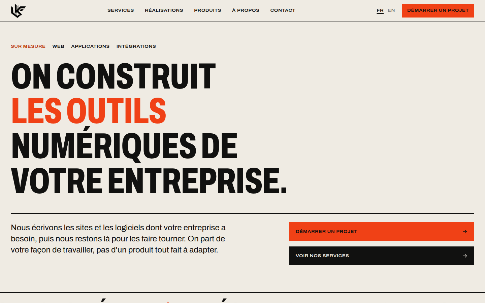
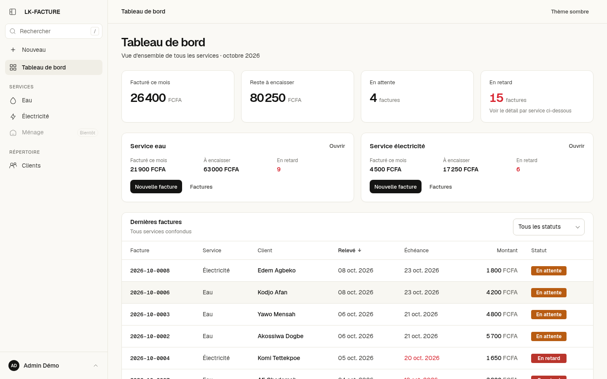
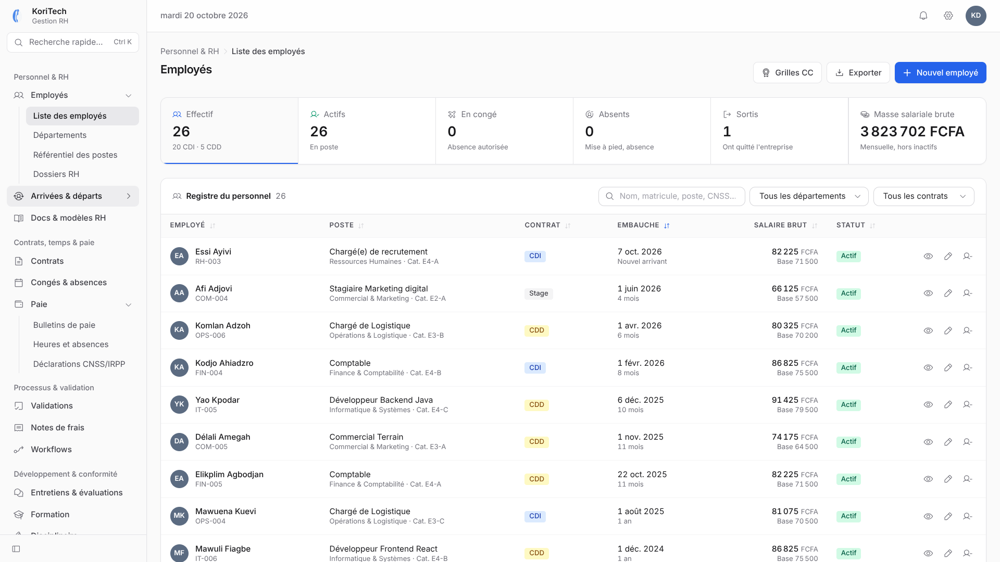
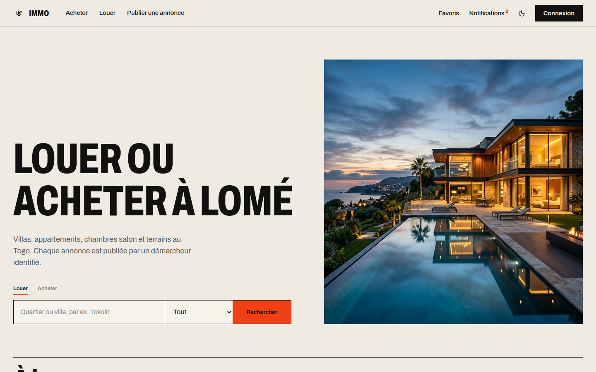
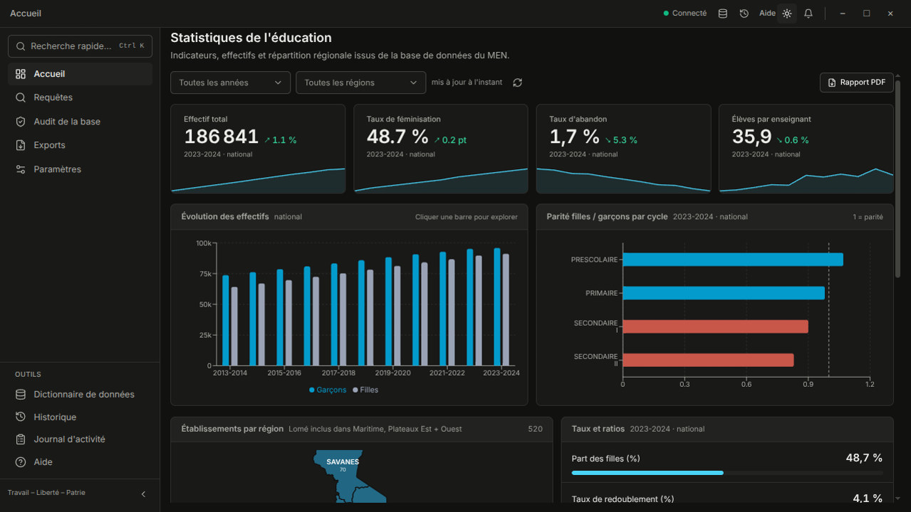
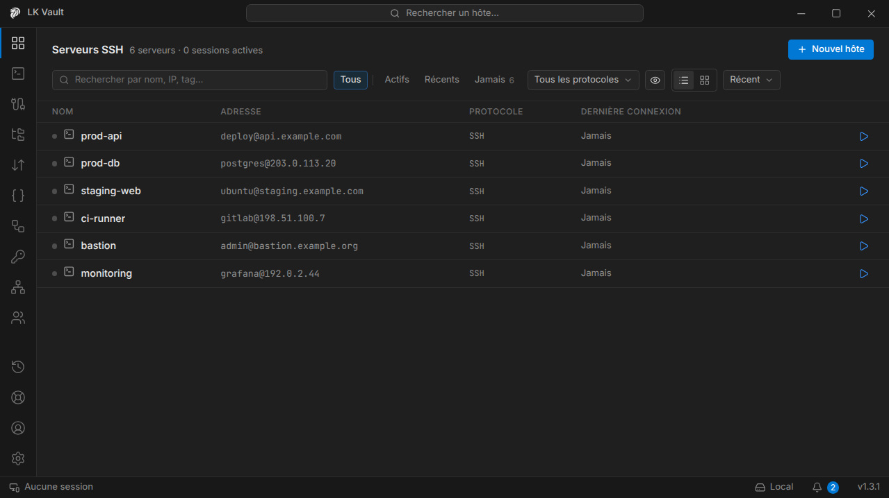
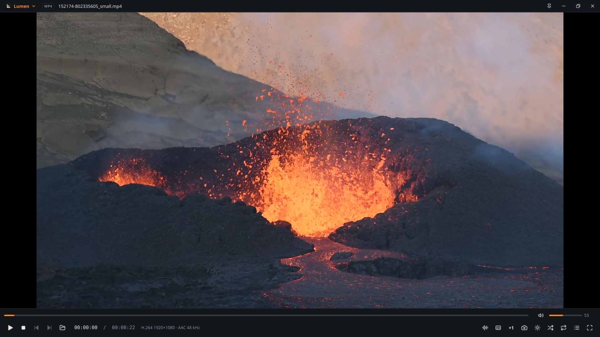
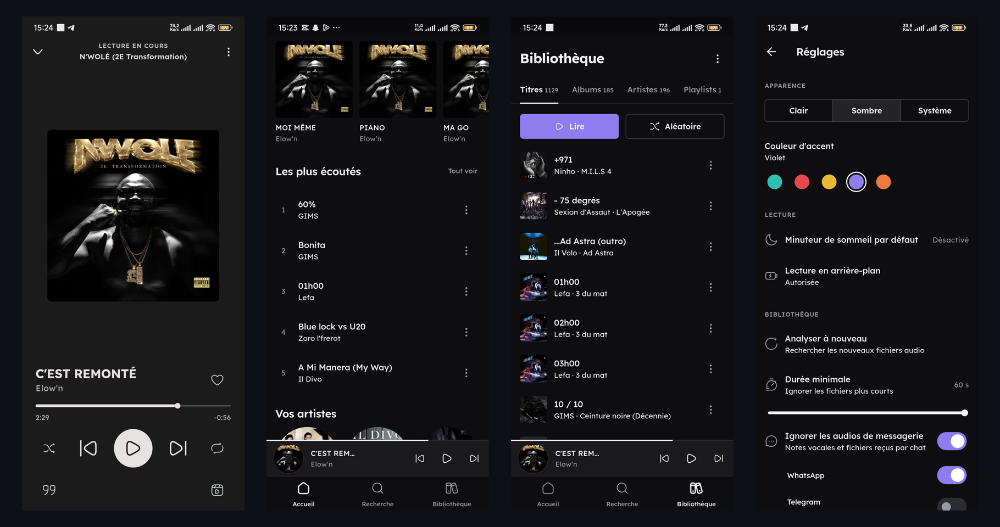

  

  

  

    
    
    
  

## 👋 À propos

Je conçois et je livre des logiciels complets, de l'analyse du besoin jusqu'à la mise en production : plateformes web, applications de bureau, outils métiers et API. Je travaille en freelance et à travers **[LK-FONDATION](https://lkfondation.com)**, mon studio de développement sur mesure basé à Lomé.

- 🏗️ **Architecture d'abord** : Clean Architecture et DDD, des fondations qui tiennent quand le produit grandit.
- 🧑‍💻 **Du code écrit pour des humains** : lisible, testé, maintenable.
- 🚀 **DevOps intégré** : Docker, CI/CD GitHub Actions, déploiement sur VPS Linux.
- 🎯 **Centré utilisateur** : livraisons itératives et MVP pour valider vite avec les vrais utilisateurs.

## 🚀 Projets

### Solutions métiers · Écosystème LK

<table>
  <tr>
    <td width="50%" valign="top">
      
      <h3>LK-FONDATION</h3>
      
Site du studio : services, réalisations et produits, en français et en anglais.

      
      
      
      
🌐 <a href="https://lkfondation.com">lkfondation.com</a>

    </td>
    <td width="50%" valign="top">
      
      <h3>LK-FACTURE</h3>
      
Facturation des services d'eau et d'électricité : relevés d'index, suivi des paiements et des retards, reçus PDF par e-mail, double authentification obligatoire.

      
      
      
      
🔒 Code source privé

    </td>
  </tr>
  <tr>
    <td width="50%" valign="top">
      
      <h3>KoriTech</h3>
      
ERP RH : employés, contrats, congés, paie et déclarations CNSS/IRPP, conforme à la Convention Collective Interprofessionnelle du Togo.

      
      
      
      
      
🔒 Code source privé

    </td>
    <td width="50%" valign="top">
      
      <h3>LK-IMMO</h3>
      
Plateforme immobilière au Togo : location et vente de villas, appartements, chambres salon et terrains, annonces publiées par des démarcheurs identifiés.

      
      
      
      
      
🌐 <a href="https://lk-immo.vercel.app/">lk-immo.vercel.app</a>

    </td>
  </tr>
  <tr>
    <td colspan="2" valign="top">
      
      <h3>Loky</h3>
      
Application de bureau pour lire les statistiques de l'éducation sans être informaticien, sur une base PostgreSQL existante : tableau de pilotage, 71 indicateurs standards, audit de qualité des données, assistant IA texte → SQL et exports Excel, PDF, CSV. Toujours en lecture seule.

      
      
      
      
      
      
🔒 Code source privé · capture réalisée sur une base de démonstration fictive

    </td>
  </tr>
</table>

### Logiciels de bureau & open source

<table>
  <tr>
    <td colspan="2" valign="top">
      
      <h3>LK Vault</h3>
      
Client SSH / SFTP / VNC local-first : coffre-fort chiffré sur la machine (AES-256-GCM), terminal multi-onglets, éditeur Monaco intégré au SFTP, snippets et macros diffusables sur plusieurs serveurs, copilote IA contextuel. Windows, macOS et Linux.

      
      
      
      
      
      
      
🌐 <a href="https://lkvault.lkfondation.com">lkvault.lkfondation.com</a>

    </td>
  </tr>
  <tr>
    <td width="50%" valign="top">
      
      <h3>PyDM</h3>
      
Gestionnaire de téléchargement pour Linux dans l'esprit d'IDM : jusqu'à 32 connexions par fichier, reprise après coupure, vidéos via yt-dlp, file d'attente et extension Firefox / Chrome.

      
      
      
      
📦 <a href="https://github.com/BenKL404/pydm">BenKL404/pydm</a>

    </td>
    <td width="50%" valign="top">
      
      <h3>Lumen</h3>
      
Lecteur vidéo pour Linux inspiré de PotPlayer : décodage matériel, reprise de lecture, YouTube et IPTV (M3U, Xtream Codes), sous-titres en ligne, thèmes. Disponible en AppImage.

      
      
      
      
📦 <a href="https://github.com/BenKL404/lumen">BenKL404/lumen</a>

    </td>
  </tr>
  <tr>
    <td colspan="2" valign="top">
      
      <h3>LKM Player</h3>
      
Lecteur audio Android pour la musique locale : bibliothèque par titres, albums et artistes, paroles synchronisées, playlists, minuteur de sommeil, thème clair/sombre et couleur d'accent. Le monorepo contient aussi une API FastAPI de téléchargement avec bot Telegram et une landing page Astro.

      
      
      
      
      
      
📦 <a href="https://github.com/BenKL404/lkm-player">BenKL404/lkm-player</a>

    </td>
  </tr>
</table>

## 🛠️ Stack

<table>
  <tr>
    <td><strong>Frontend</strong></td>
    <td></td>
  </tr>
  <tr>
    <td><strong>Backend</strong></td>
    <td></td>
  </tr>
  <tr>
    <td><strong>Bureau & mobile</strong></td>
    <td></td>
  </tr>
  <tr>
    <td><strong>Données</strong></td>
    <td></td>
  </tr>
  <tr>
    <td><strong>DevOps & outils</strong></td>
    <td></td>
  </tr>
</table>

## 📈 Activité

  
  
    
  <picture>
    <source media="(prefers-color-scheme: dark)" srcset="https://raw.githubusercontent.com/BenKL404/BenKL404/output/github-contribution-grid-snake-dark.svg">
    <source media="(prefers-color-scheme: light)" srcset="https://raw.githubusercontent.com/BenKL404/BenKL404/output/github-contribution-grid-snake.svg">
    
  </picture>

## 🤝 Travaillons ensemble

Un projet de plateforme web, d'outil métier, d'application de bureau ou d'API ? Je suis disponible pour des missions en freelance, à distance ou sur site au Togo.

**Services :** MVP pour startups · Back-offices et outils de gestion · Applications web et mobiles · Audit technique

  
  

  
   
  

